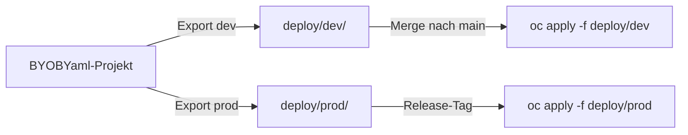

# dev und prod aus einem Projekt

Ein Projekt, mehrere Umgebungen: Alles, was sich zwischen den Umgebungen unterscheidet, wird eine [Variable](../funktionen/variablen.md).

## Typische Variablen

| Variable | dev | staging | prod |
| --- | --- | --- | --- |
| `NAMESPACE` | `shop-dev` | `shop-stage` | `shop-prod` |
| `REPLICAS` | `1` | `2` | `4` |
| `TAG` | `latest` | `rc` | `1.8.2` |
| `HOST` | `shop.dev.intra` | `shop.stage.intra` | `shop.example.com` |
| `CPU_LIMIT` | `500m` | `1` | `2` |
| `LOG_LEVEL` | `debug` | `info` | `warn` |

Eine weitere Umgebung legst du im Tab Variablen an: Namen ins Feld *neue Umgebung* tippen und <kbd>Enter</kbd> drücken.

## Blöcke

Dasselbe Prinzip im Beispielprojekt *OpenShift Demo-App*, mit den Variablen `APP`, `NAMESPACE` und `REPLICAS`. Die Felder enthalten nur Platzhalter; auch zusammengesetzte Werte wie der Hostname funktionieren:

### Umgebung dev

### Umgebung prod

Oben rechts **Umgebung** auf `prod` stellen. Die Blöcke bleiben unverändert:

| Feld im Block | dev | prod |
| --- | --- | --- |
| `Replicas ${REPLICAS}` | `replicas: 1` | `replicas: 3` |
| `im Namespace ${NAMESPACE}` | `namespace: demo-dev` | `namespace: demo-prod` |
| `Hostname ${APP}.${NAMESPACE}.apps.example.com` | `demo-app.demo-dev.apps.example.com` | `demo-app.demo-prod.apps.example.com` |

Für die Tabelle oben (`TAG`, `HOST`, `CPU_LIMIT`, `LOG_LEVEL`) gilt dasselbe: Variable anlegen, `${NAME}` ins passende Feld schreiben.

## Export pro Umgebung

Der Eintrag *Alle Dateien in Ordner…* zeigt rechts die aktive Umgebung. Ablauf:

1. Umgebung `dev` wählen → *Alle Dateien in Ordner…* → `deploy/dev`
2. Umgebung `prod` wählen → *Alle Dateien in Ordner…* → `deploy/prod`

Mit Git und CI/CD:

:::tip Unterschiede prüfen
Ein `git diff --no-index deploy/dev deploy/prod` zeigt genau, worin sich die Umgebungen unterscheiden.
:::
