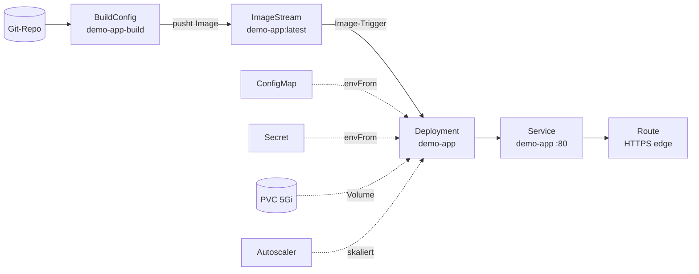

# OpenShift: Build → Deploy → Route

Ziel: Eine App aus einem Git-Repository in OpenShift bauen, deployen und per HTTPS erreichbar machen. Das Beispielprojekt **OpenShift Demo-App** (Projektverwaltung → *Beispiel: OpenShift*) enthält genau diesen Aufbau. Alle Screenshots stammen daraus.



## 1. Variablen anlegen

Tab **Variablen**:


| Name | dev | prod |
| --- | --- | --- |
| `APP` | `demo-app` | `demo-app` |
| `NAMESPACE` | `demo-dev` | `demo-prod` |
| `REPLICAS` | `1` | `3` |

Im Beispielprojekt nutzen der Namespace (`01-namespace.yaml`) und das Deployment die Variablen. Die übrigen Dateien haben feste Namen. Mit Variablen funktioniert jede Datei genauso.

## 2. ImageStream

Datei `02-imagestream.yaml`. Startblock **Ressourcen → ImageStream**:


Der ImageStream ist das Ziel, in das die BuildConfig ihr Image schreibt.

## 3. BuildConfig

Datei `03-buildconfig.yaml`, oder du nimmst die Vorlage *BuildConfig Docker + Webhook*:


| Block | Wirkung |
| --- | --- |
| **BuildConfig** … → ImageStreamTag `demo-app:latest` | `spec.output.to`: wohin das fertige Image geht |
| **Git Quelle** | `spec.source.git`: Repository und Branch |
| **Docker-Strategie** | `spec.strategy`: baut mit dem `Dockerfile` im Repo |
| **Build starten bei Config-Änderung** | `ConfigChange`-Trigger: erster Build direkt nach dem Anlegen |

Für automatische Builds bei jedem Push brauchst du zusätzlich einen Webhook-Trigger, also einen Block *Build starten bei GitHub Push* mit Webhook-Secret.

## 4. Deployment mit Image-Trigger

Datei `04-deployment.yaml`:


- **neues Image aus `demo-app:latest` → Container `demo-app` aktualisieren** setzt die Annotation `image.openshift.io/triggers`. Damit tauscht OpenShift das Image aus, sobald der ImageStreamTag ein neues bekommt.
- **Image Pull Secret** und **Volume aus PVC** gelten für den ganzen Pod.
- Im **Container**: Port, Requests und Limits, Config und Secret als Umgebungsvariablen, Volume-Mount und Readiness-Probe.
- Im Startblock stehen `${APP}` und `${REPLICAS}`. Bei `dev` ergibt das `replicas: 1`, bei `prod` `replicas: 3`.

:::note Non-root
OpenShift startet Container mit einer zufälligen UID. Die App muss auf einem Port über 1024 lauschen (hier 8080) und darf keine Root-Rechte brauchen.
:::

## 5. Service und Route

| `05-service.yaml` | `06-route.yaml` |
| --- | --- |
|  |  |

Der Service verteilt auf Port 80 an die Pods mit `app: demo-app` (Port 8080). Die Route verweist auf den Service-Port mit dem Namen `http` und terminiert TLS am Router (`edge`). HTTP wird auf HTTPS umgeleitet. OpenShift vergibt den Hostnamen automatisch; einen eigenen setzt du mit dem Block *Hostname*.

## 6. Config, Secrets, Speicher, Autoscaling

| Datei | Blöcke |
| --- | --- |
| `07-secret.yaml` | Secret Opaque + Einträge `DB_USERNAME`, `DB_PASSWORD` |
| `08-configmap.yaml` | ConfigMap + Einträge `APP_ENV`, `LOG_LEVEL` … |
| `10-registry-secret.yaml` | Secret + *Registry-Login* (erzeugt `.dockerconfigjson`) |
| `11-pvc.yaml` | Speicher (PVC) 5Gi ReadWriteOnce |
| `12-hpa.yaml` | Autoscaler min 2 max 5 + Ziel CPU 70 % |


## 7. Ausrollen

*Exportieren → Alle Dateien in Ordner…* → z. B. `deploy/dev`:


Dann:

```bash
oc new-project demo-dev
oc apply -f deploy/dev/
oc logs -f bc/demo-app-build
oc get route demo-app
```

Für prod: Umgebung oben rechts auf `prod` umschalten, in `deploy/prod` exportieren und dort `oc apply` ausführen.
