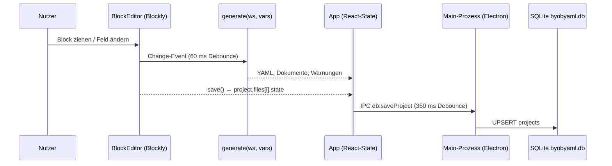
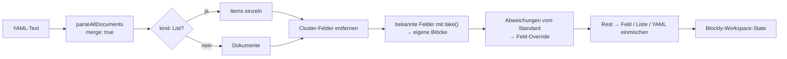

# Architektur

## Stack

| Schicht | Technik |
| --- | --- |
| Desktop-Hülle | Electron 45 (`electron/main.cjs`, `preload.cjs`) |
| Speicher | `node:sqlite` im Main-Prozess (`electron/db.cjs`) |
| UI | React 19 + TypeScript, gebaut mit Vite |
| Block-Editor | [Blockly](https://developers.google.com/blockly) 13, Renderer `thrasos`, eigenes dunkles Theme |
| YAML | [`yaml`](https://eemeli.org/yaml/) (Parse + Stringify) |
| Paketmanager | Bun |
| Doku | Docusaurus 3 (`docs-site/`) |

## Ordner

```text
BYOBYaml/
├── electron/
│   ├── main.cjs          Fenster, Datei-Dialoge, IPC
│   ├── preload.cjs       window.byob (contextBridge)
│   └── db.cjs            SQLite-Schema und Abfragen
├── src/
│   ├── blocks/
│   │   ├── types.ts      Kategorien, Farben, DSL-Helfer, Ctx
│   │   ├── defs.ts       ALLE Blöcke: Aussehen + YAML-Erzeugung
│   │   ├── register.ts   Blockly-Registrierung, Theme, Toolbox, Kontextmenü
│   │   └── generator.ts  Blöcke → YAML, Variablen, Warnungen
│   ├── importer.ts       YAML → Blöcke
│   ├── snippets.ts       mitgelieferte Vorlagen
│   ├── examples.ts       Beispielprojekte
│   ├── project.ts        Datenmodell, .byob-Format
│   ├── storage.ts        SQLite (IPC) oder localStorage, Datei-I/O
│   ├── App.tsx           Layout und Zustand
│   └── components/       BlockEditor, YamlView, Panels, Dialogs, Icons
├── scripts/
│   ├── roundtrip.ts      Import-Round-Trip-Test
│   ├── gen-docs.ts       erzeugt die Block-Referenz dieser Doku
│   └── samples/          Test-YAMLs
└── docs-site/            diese Dokumentation
```

## Datenfluss



Sichtbar wird der Ablauf in der App: Links ändert sich ein Block, rechts erscheint das YAML, und die Statusleiste meldet *Gespeichert*.


## Generator

`generate()` geht alle **aktiven Startblöcke** der Fläche von oben nach unten durch. Jeder Block hat in `defs.ts` eine `gen(values, ctx, run)`-Funktion:

- `values`: Feldwerte; Variablen sind schon eingesetzt, Zahlen schon umgewandelt
- `ctx`: aktuelles Dokument (`doc`), aktuelles Objekt (`target`), dazu `pod`/`podMeta`/`container` und die aktiven Wirkungsbereiche (`scopes`)
- `run(scopes, patch)`: führt die Kind-Blöcke mit erweitertem Kontext aus; bei Startblöcken die Blöcke darunter, bei Klammerblöcken den Inhalt

Passt ein Block nicht zum Kontext (`spec.scope` ∩ `ctx.scopes` ist leer), wird er übersprungen und bekommt eine Warnung.

Am Ende entfernt `prune()` leere Objekte, leere Listen und `undefined`. Dann serialisiert `yaml.stringify` das Ergebnis (`lineWidth: 0`, `nullStr: ''`).

## Importer



`importYaml()` parst alle Dokumente (mit Merge-Keys). Pro Ressource gilt:

1. Cluster-Felder entfernen
2. bekannte Felder mit `take()` entnehmen → dedizierte Blöcke
3. Abweichungen von Standardwerten der Startblöcke → *Feld*-Override-Blöcke
4. Rest über `leftovers()` → *Feld* / *Liste* / *YAML einmischen*

Weil jede entnommene Eigenschaft aus einer Kopie gelöscht wird, kann nichts doppelt oder gar nicht übernommen werden.

Beispiel eines Imports, sichtbar als Bericht und Blöcke:

| Bericht | Ergebnis |
| --- | --- |
|  |  |

## Sicherheit

- `contextIsolation: true`, `sandbox: true`, `nodeIntegration: false`
- Der Renderer kommt nur über die freigegebenen Funktionen in `window.byob` an Dateisystem und Datenbank
- Navigation weg von der App ist blockiert; externe Links öffnen im Standardbrowser
- Export in Ordner schreibt nur `path.basename(name)`, also kein Path-Traversal über Dateinamen
