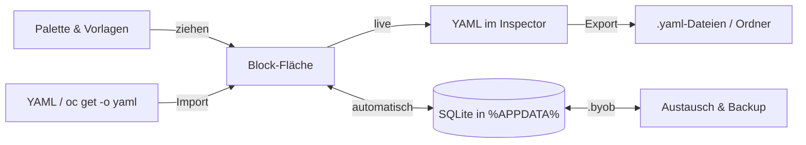

# Was ist BYOBYaml?

**BYOBYaml** („Build Your Own Blocks → YAML“) ist ein visueller Editor für Infrastruktur-Konfigurationen. Statt YAML von Hand einzurücken, steckst du Blöcke zusammen, ähnlich wie in Scratch. BYOBYaml erzeugt daraus live gültiges YAML für:

- **Docker Compose** (`docker-compose.yml` / `compose.yaml`)
- **Kubernetes**: Deployment, StatefulSet, DaemonSet, Job, CronJob, Service, Ingress, ConfigMap, Secret, PVC, HPA, ServiceAccount, Namespace
- **OpenShift**: Route, ImageStream, BuildConfig, Image-Trigger
- **jede andere Ressource**, z. B. CRDs wie `Certificate` oder `NetworkPolicy`, über den Block *Eigene Ressource* und die [Extras](funktionen/extras.md)

Der Weg geht auch andersherum: Vorhandenes YAML [importierst](funktionen/import.md) du zurück in Blöcke. Was keinen eigenen Block hat, wird zu einem Extras-Block. So geht beim Import nichts verloren.

## Für wen?

- **Admins und Entwickler**, die schnell ein sauberes Manifest brauchen, ohne jedes Feld nachzuschlagen
- **Teams**, die wiederkehrende Bausteine als [Vorlagen](vorlagen/eigene-vorlagen.md) teilen wollen
- **Lernende**, die sehen wollen, welcher Block welches YAML erzeugt

## Auf einen Blick

| Funktion | Kurz |
| --- | --- |
| Live-YAML | Jede Änderung erscheint sofort rechts im Inspector |
| Prüfung | Steckt ein Block an der falschen Stelle, siehst du ⚠ am Block und im Tab *Probleme* |
| Variablen | `${NAME}` in jedem Feld, Werte pro Umgebung (dev/prod/…) |
| Import | `.yaml`/`.yml` aus Dateien, Zwischenablage oder per Drag & Drop |
| Export | Einzelne Datei, alle Dateien in einen Ordner, Projekt als `.byob`, Komplett-Backup |
| Speicherung | Automatisch in SQLite unter `%APPDATA%\BYOBYaml\byobyaml.db` |
| Vorlagen | 43 mitgelieferte Block-Kombinationen und eigene |

## Wie es funktioniert

Links wählst du die **Datei**, in der Mitte steckst du **Blöcke** aus der Palette zusammen, rechts entsteht das **YAML**. Dieselben Blöcke ergeben je nach [Umgebung](funktionen/variablen.md) unterschiedliche Werte. Hier steht `${REPLICAS}` im Block, und im YAML erscheint `replicas: 1` für `dev`.

Weiter mit der [Installation](installation.md) oder direkt mit den [ersten Schritten](erste-schritte.md).
